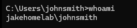

 <h1>whoami Command Line Tools</h1>

-  whoami — Displays the currently signed-in user account and domain.

- whoami /groups — Lists the security groups associated with the current logon session, helping verify group membership and access permissions.

